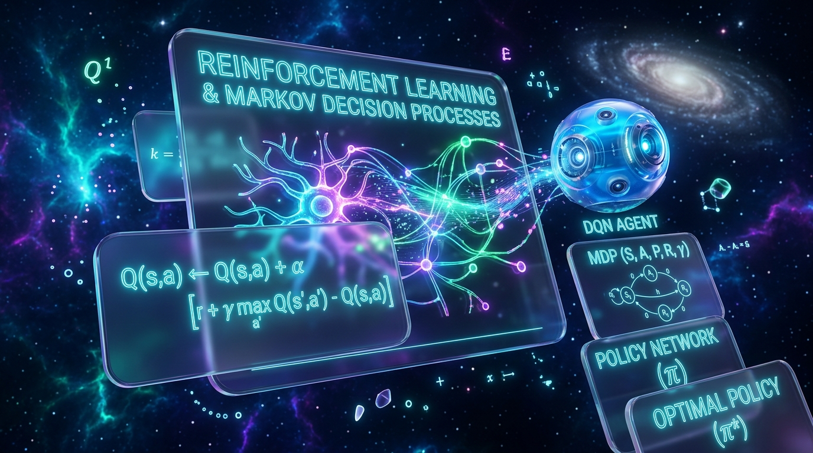
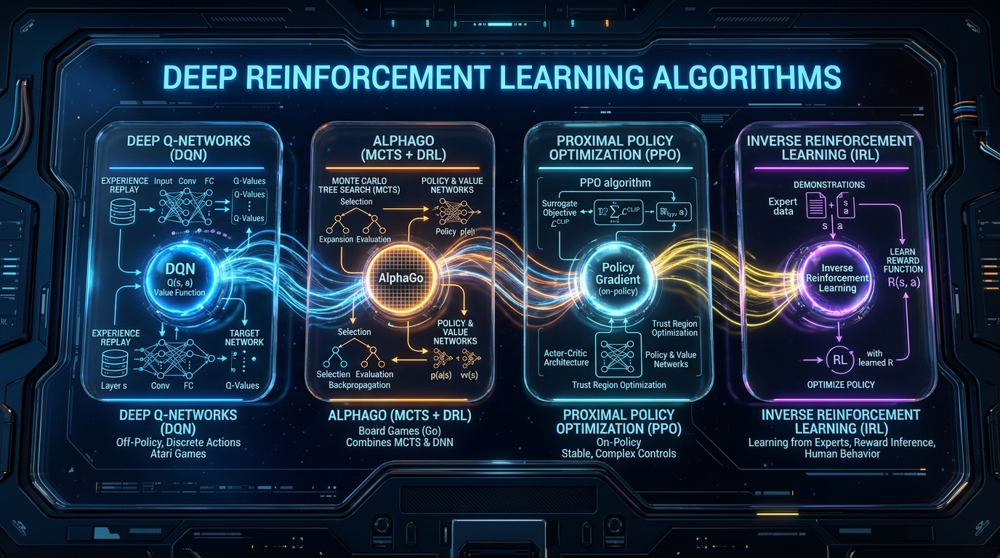

# 🌌 KTU S5 AI Module 4: Reinforcement Learning Master Knowledge System

[](https://ktu-ai-module4-rl.vercel.app)
[](https://github.com/Janeferdinant/KTU-AI-Module4-Reinforcement-Learning)
[](https://ktu.edu.in)
[]()
[]()

An ultra-modern, production-grade interactive educational platform solving the complete curriculum for **APJ Abdul Kalam Technological University (KTU) Semester 5 Artificial Intelligence — Module 4: Reinforcement Learning (RL)**.

Built with an **Apple visionOS-inspired Liquid Glass Design System**, working visual AI algorithm simulations, real-world industrial models, an interactive university exam numerical solver, and full local deployment architectures.

---

## 🎨 System Visual Architecture & Hero Overview



---

## 🚀 Live Online Deployment (Vercel)

- **Production URL:** [https://ktu-ai-module4-rl.vercel.app](https://ktu-ai-module4-rl.vercel.app)
- **GitHub Repository:** [https://github.com/Janeferdinant/KTU-AI-Module4-Reinforcement-Learning](https://github.com/Janeferdinant/KTU-AI-Module4-Reinforcement-Learning)

---

## 📚 Complete Syllabus Theory & Mathematical Solutions ("Solve It")

The platform provides mathematically rigorous coverage of all Module 4 topics:

### 1. Fundamentals of RL & Markov Decision Processes (MDP)
- **Agent-Environment Dynamic:** Agent interacts with environment $E$ observing state $s_t \in \mathcal{S}$, choosing action $a_t \in \mathcal{A}$, receiving scalar feedback $r_t \in \mathbb{R}$, transitioning to $s_{t+1} \in \mathcal{S}$.
- **MDP 5-Tuple:** $\mathcal{M} = \langle S, A, T, R, \gamma \rangle$:
  - $S$: Set of states.
  - $A$: Set of actions.
  - $T(s, a, s') = P(s' \mid s, a)$: Transition probability function obeying the **Markov Property**:
    $$P(S_{t+1}=s' \mid S_t=s, A_t=a, S_{t-1}, A_{t-1}, \dots) = P(S_{t+1}=s' \mid S_t=s, A_t=a)$$
  - $R(s, a, s')$: Reward function.
  - $\gamma \in [0, 1)$: Discount factor.
- **Discounted Return:**
  $$G_t = \sum_{k=0}^{\infty} \gamma^k R_{t+k+1} = R_{t+1} + \gamma R_{t+2} + \gamma^2 R_{t+3} + \dots$$
  - $\gamma \to 0$: Myopic agent (prioritizes immediate rewards).
  - $\gamma \to 1$: Far-sighted agent (values long-term accumulated rewards).

### 2. Passive Reinforcement Learning
Policy $\pi$ is fixed. Objective: evaluate utility $U^\pi(s)$.
1. **Direct Utility Estimation (Monte Carlo):** Calculates sample mean of complete episode returns:
   $$U(s) = \frac{1}{N(s)} \sum_{i=1}^{N(s)} G_i(s)$$
2. **Adaptive Dynamic Programming (ADP):** Learns transition model $\hat{T}(s, \pi(s), s')$ from empirical frequency counts and solves the system of Bellman linear equations:
   $$U^\pi(s) = R(s) + \gamma \sum_{s'} \hat{T}(s, \pi(s), s') U^\pi(s')$$
   *Sample efficient, but $O(|S|^3)$ computational complexity.*
3. **Temporal-Difference TD(0) Learning:** Model-free bootstrapping updating predictions online using the **TD Error** $\delta$:
   $$U(s) \leftarrow U(s) + \alpha \underbrace{\left[ R(s) + \gamma U(s') - U(s) \right]}_{\text{TD Error } \delta}$$

### 3. Active Reinforcement Learning: Q-Learning vs. SARSA
Balancing exploration vs. exploitation ($\epsilon$-greedy policy):
- **Q-Learning (Watkins 1989 / 1992) — Off-Policy TD Control:**
  Updates $Q(s,a)$ towards the Bellman optimality target $\max_{a'} Q(s', a')$ regardless of which exploratory action the agent actually selects:
  $$Q(s, a) \leftarrow Q(s, a) + \alpha \left[ R(s,a) + \gamma \max_{a'} Q(s', a') - Q(s, a) \right]$$
- **SARSA (Rummery & Niranjan 1994) — On-Policy TD Control:**
  Tuple $(s, a, r, s', a')$. Updates towards the actual next action $a'$ chosen by the behavior policy:
  $$Q(s, a) \leftarrow Q(s, a) + \alpha \left[ R(s,a) + \gamma Q(s', a') - Q(s, a) \right]$$
- **Safety Contrast:** Q-Learning discovers the shortest risky path directly alongside cliff edges; SARSA discovers longer, conservative paths routed away from hazard zones.

### 4. Generalization & Function Approximation
Overcoming the curse of dimensionality in continuous/massive state spaces:
- **Linear Feature Approximation:**
  $$\hat{U}(s) = \mathbf{w}^T \mathbf{x}(s) = \sum_{i=1}^d w_i f_i(s)$$
- **Deep Neural Network Approximation:**
  $$\hat{Q}(s, a; \mathbf{w}) \approx Q^*(s, a)$$
- **State Abstraction:** Coarsening and grouping states sharing invariant transition dynamics.

### 5. Policy Search & Policy Gradients
Directly optimizes parameterized policies $\pi_\theta(a|s)$ without requiring tabular value functions:
- **Policy Gradient Update:**
  $$\theta \leftarrow \theta + \alpha \nabla_\theta J(\theta)$$
  Derived via the **Policy Gradient Theorem (REINFORCE)**:
  $$\nabla_\theta J(\theta) = \mathbb{E}_{\tau \sim \pi_\theta} \left[ \sum_{t=0}^T \nabla_\theta \log \pi_\theta(a_t \mid s_t) G_t \right]$$

### 6. Apprenticeship Learning & Inverse Reinforcement Learning (IRL)
- **Apprenticeship Learning:** Learning directly from expert demonstrations $\mathcal{D} = \{\tau_1, \tau_2, \dots\}$.
- **Inverse RL (Ng & Russell 2000):** Inverting the MDP to recover the latent reward function $R^*(s)$ under which the expert's behavior is optimal.

---

## 🔬 Top 5 Landmark Research Papers & Interactive Demos



| Rank | Milestone Research Paper | Key Contribution | Live Visual Demo in Dashboard |
| :---: | :--- | :--- | :--- |
| **#1** | **Mnih et al. (Nature 2015)**<br>*Human-Level Control Through Deep RL* | Deep Q-Networks (DQN), Experience Replay Buffer, Target Network ($\theta^-$) | **Replay Buffer Visualizer:** Animated circular buffer memory with uniform mini-batch sampling and target network synchronization. |
| **#2** | **Silver et al. (Nature 2016)**<br>*Mastering Go with Deep Nets & Tree Search* | AlphaGo: Dual-head Policy/Value Networks + MCTS with PUCT search | **Interactive MCTS Simulator:** Selection (PUCT), Expansion, Rollout, and Backpropagation of visit counts $N(s,a)$ and values $Q(s,a)$. |
| **#3** | **Schulman et al. (OpenAI 2017)**<br>*Proximal Policy Optimization (PPO)* | Clipped Surrogate Objective $L^{CLIP}(\theta)$ preventing policy collapse | **PPO Clipped Objective Visualizer:** Interactive graph plotting ratio $r_t(\theta)$, advantage $\hat{A}_t$, and the $[1-\epsilon, 1+\epsilon]$ clipping band. |
| **#4** | **Ng & Russell (ICML 2000)**<br>*Algorithms for Inverse Reinforcement Learning* | LP formulation recovering latent rewards from expert paths | **IRL Inferrer:** Computes the inferred reward matrix $R(s)$ from expert demonstration trajectories with maximum margin separation. |
| **#5** | **Watkins & Dayan (1992) / Sutton (1988)**<br>*Q-Learning & Temporal Differences* | Foundational Off-Policy and On-Policy TD control | **Live Cliff-Walking Arena:** 4×12 grid world with live agent training, Q-value direction arrows, state heatmaps, and a real-time reward curve chart. |

---

## ⚡ Real-World Industrial Simulations

1. **Smart Power Grid Battery Storage Dispatch:**
   - 24-hour simulation balancing fluctuating solar PV generation curves, dynamic peak electricity tariffs ($/kWh), and facility demand.
   - Live animated battery gauge displaying State of Charge (SoC), accumulated cost savings, and charge/discharge state transitions.
2. **Autonomous Mobile Robot LIDAR Navigation:**
   - 2D LIDAR raycast distance sensors navigating around dynamic moving obstacles toward an adjustable goal beacon, illustrating feature-based generalization.

---

## 🧮 KTU Exam Numerical Problem Solver

An instant step-by-step calculator for university exam questions:
- **Temporal-Difference TD(0) Calculator:** Computes target $R(s) + \gamma U(s')$, TD error $\delta$, and updated utility $U(s)$.
- **Q-Learning Step Calculator:** Computes Bellman optimality target $R + \gamma \max_{a'} Q(s',a')$ and updated $Q(s,a)$.
- **Discounted Return ($G_t$) Trajectory Calculator:** Computes trajectory expansions for arbitrary sequences of rewards $R_{t+1}, R_{t+2}, \dots$ and discount $\gamma$.
- **SARSA Step Calculator:** Computes on-policy target $R + \gamma Q(s',a')$ and updated action-value.

---

## 🛠️ Local Development & Deployment

### Run Locally in 5 Seconds
```bash
# Clone the repository
git clone https://github.com/Janeferdinant/KTU-AI-Module4-Reinforcement-Learning.git
cd KTU-AI-Module4-Reinforcement-Learning

# Option A: Built-in Python Server
python -m http.server 8080

# Option B: Node.js Serve
npx serve .

# Open in browser:
http://localhost:8080/index.html
```

### Python RL Environment & Gymnasium Setup
```bash
# 1. Create and activate virtual environment
python -m venv .venv
.\\.venv\\Scripts\\Activate.ps1  # Windows
source .venv/bin/activate       # Linux/macOS

# 2. Install dependencies
pip install torch torchvision
pip install gymnasium[classic-control] stable-baselines3 fastapi uvicorn
```

### Docker Deployment
```bash
docker build -t rl-module4-dashboard .
docker run -p 8080:80 rl-module4-dashboard
```

---

## 👤 Author & Credits

- **Curated & Developed By:** **Jane Rose**
- **Course:** KTU S5 Artificial Intelligence (CST306) — Module 4: Reinforcement Learning
- **License:** MIT License
- **Copyright:** &copy; 2026 Jane Rose. All rights reserved.
